<div align="center">

# 📈 StockAdvisor AI
### Full-Stack FinTech Dashboard · AI-Powered Stock Insights

**Turn market data into clearer insights. Explore stocks, understand news sentiment, and build a portfolio allocation based on your selected risk profile.**


</div>

---

## 📑 Table of Contents

- [Overview](#-overview)
- [Application Previews](#-application-previews)
- [Key Features](#-key-features)
- [System Architecture](#-system-architecture)
- [Data and Analysis Pipelines](#-data-and-analysis-pipelines)
- [Technology Stack](#-technology-stack)
- [Project Structure](#-project-structure)
- [Getting Started](#-getting-started)
- [Environment Configuration](#-environment-configuration)
- [API Overview](#-api-overview)
- [How the Recommendation Logic Works](#-how-the-recommendation-logic-works)
- [Security and Limitations](#-security-and-limitations)
- [Future Improvements](#-future-improvements)

---

## 🌟 Overview

**StockAdvisor AI** is a full-stack financial dashboard that combines portfolio allocation logic, historical stock data, and news sentiment analysis in one interface.

The application uses a **React + Vite** frontend and a **Python + Flask** backend. The backend retrieves market information through `yfinance`, collects headlines from Google News RSS, analyzes headline sentiment with VADER, and provides API responses to the frontend. User accounts and saved watchlist entries are stored in SQLite.

The goal is to make financial information easier to explore through visualizations and explainable signals—not to guarantee investment returns or replace professional financial advice.

## 📸 Application Previews

Add your screenshots to a `screenshots/` directory using the filenames below. If your filenames differ, update the image paths.

| Login Screen | Portfolio Builder | Stock Investigator |
|:---:|:---:|:---:|
| 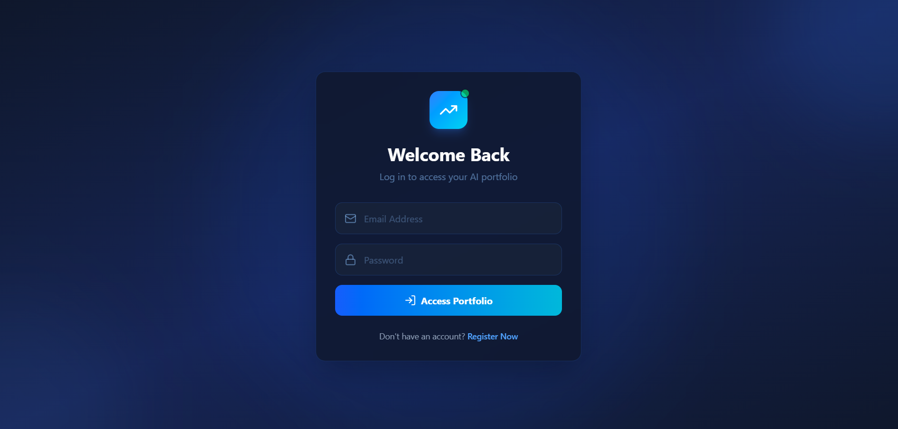 | 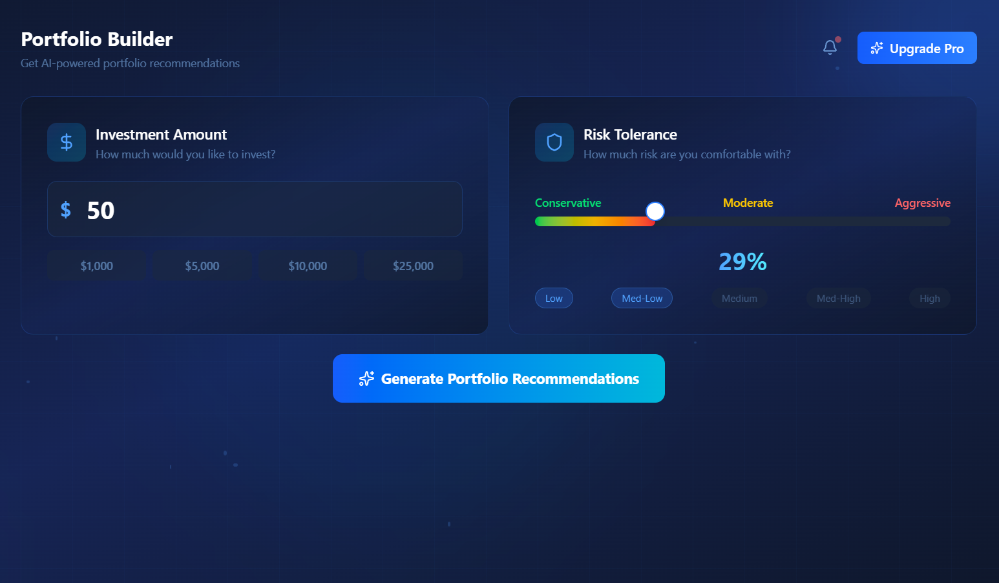 | 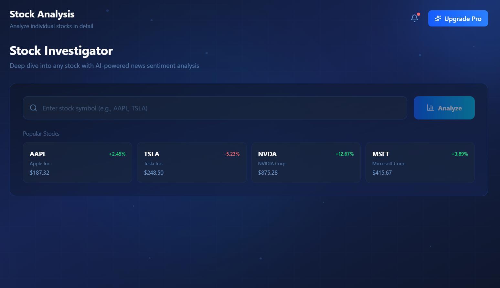 |

| AI Verdict & Sentiment | Watchlist | Historical Price Chart |
|:---:|:---:|:---:|
| 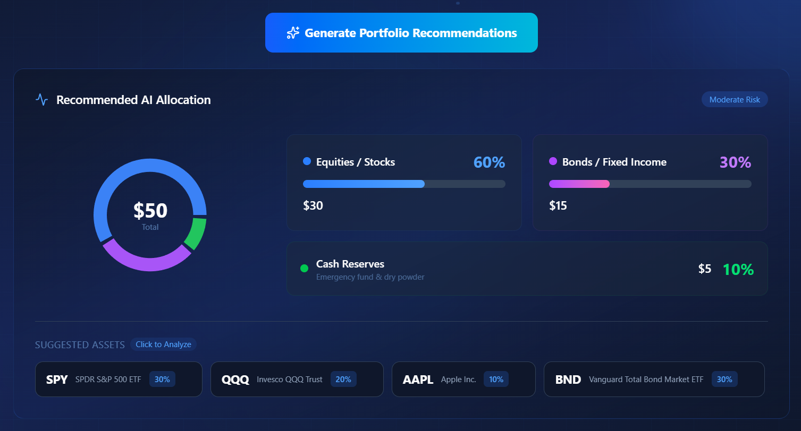 | 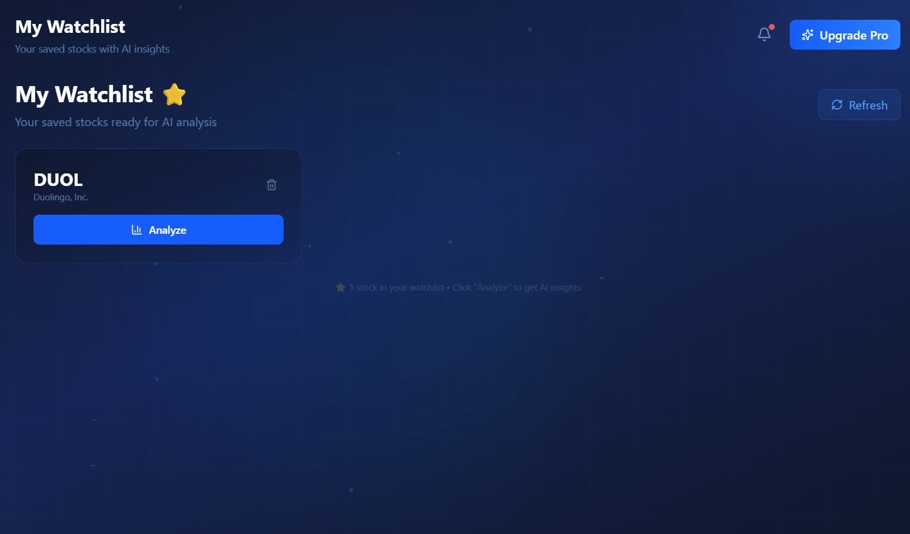 | 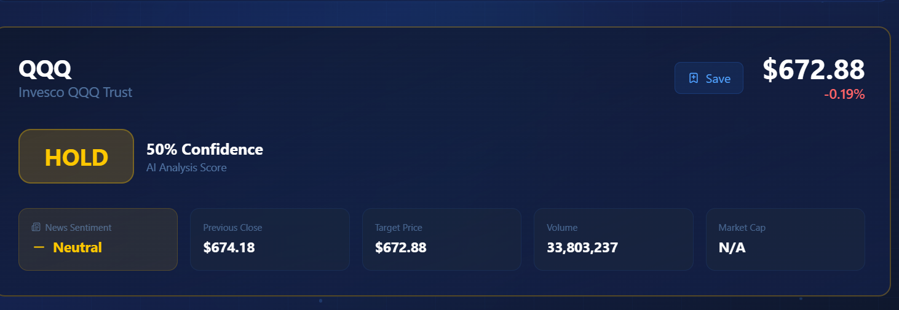 |

## ✨ Key Features

### 🔐 User Authentication
- User registration and login.
- Password hashing using Werkzeug security utilities (PBKDF2-SHA256, depending on the installed Werkzeug version/configuration).
- SQLite persistence for user and watchlist records.
- Session-based user experience and profile display.

### 🧠 AI Portfolio Builder
- Risk-tolerance input from 0–100%.
- Quick investment amount presets: $1K, $5K, $10K and $25K.
- Allocation recommendations across stocks, bonds and cash.
- Interactive Recharts donut chart.
- Number formatting for readable investment values.
- Clickable ticker shortcuts to open stock analysis.

### 📰 News Sentiment Analysis
- Retrieves headlines from Google News RSS feeds.
- Parses RSS/XML responses using Python standard-library tools.
- Scores headline sentiment with VADER.
- Groups results into positive, neutral and negative sentiment.
- Combines available price-related signals and news mood in the application's analysis/confidence logic.

### 📊 Stock Investigation
- Retrieves historical market data through `yfinance`.
- Displays a 30-day historical price chart (subject to available market data).
- Presents an application-generated verdict: **STRONG BUY, BUY, HOLD, SELL or STRONG SELL**.
- Displays sentiment scores and related headlines.
- Uses visual indicators to make analysis easier to scan.

### ⭐ Persistent Watchlist
- Save analyzed tickers to the user's watchlist.
- Display saved stocks in individual cards.
- Reopen stock analysis from a saved ticker.
- Remove tickers from the watchlist.
- Refresh watchlist data from the backend.

---

## 🏗️ System Architecture

The application uses a browser-based frontend communicating with a Flask REST API. The Flask backend coordinates database operations and external financial/news data sources.

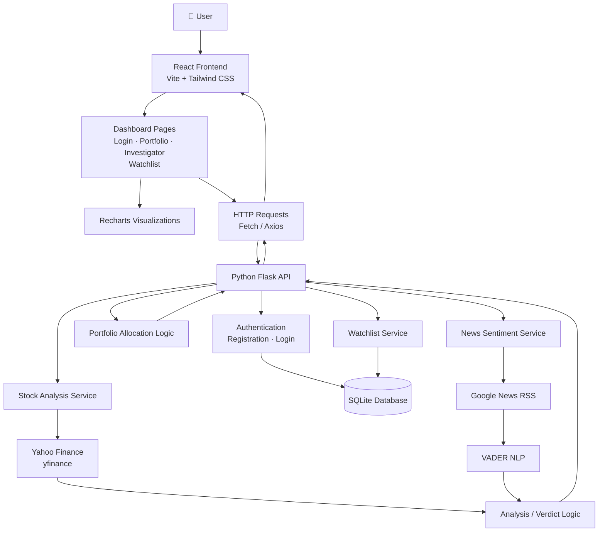

### Component responsibilities

| Component | Responsibility |
|---|---|
| React UI | Renders pages, forms, dashboard cards and interactive controls |
| Vite | Runs the frontend development server and creates production builds |
| Tailwind CSS | Provides utility-based styling and responsive layouts |
| Recharts | Renders portfolio and stock visualizations |
| Flask API | Exposes endpoints and coordinates application services |
| Authentication logic | Registers users, verifies credentials and manages login state |
| Portfolio logic | Calculates an allocation based on the selected investment amount and risk input |
| Stock data service | Retrieves historical market data using `yfinance` |
| News service | Fetches and parses Google News RSS headlines |
| VADER | Calculates sentiment polarity from headline text |
| SQLite | Persists user and watchlist information |

## 🔄 Data and Analysis Pipelines

### 1. Stock investigation pipeline

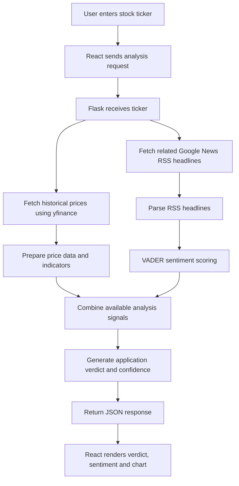

### 2. News sentiment pipeline

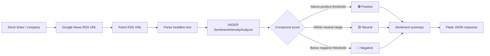

### 3. Portfolio allocation pipeline

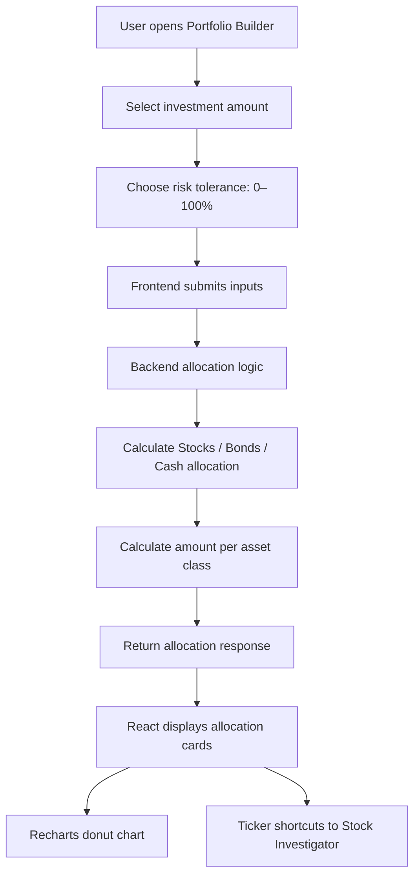

### 4. Authentication and watchlist pipeline

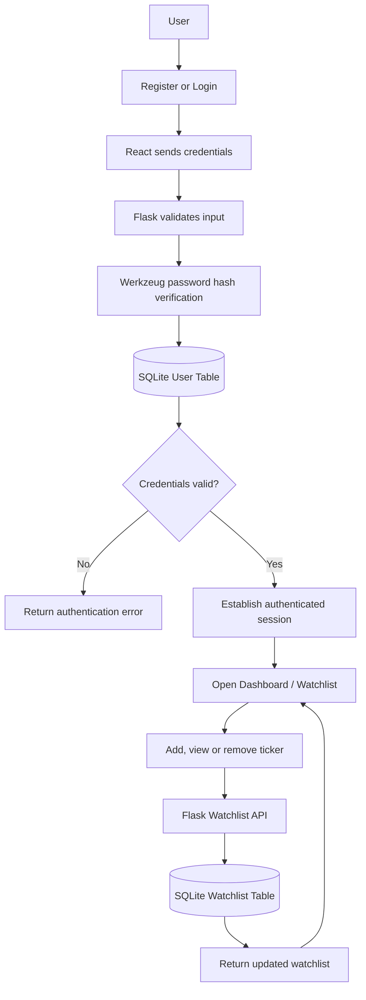

## 🛠️ Technology Stack

### Frontend

| Technology | Role |
|---|---|
| React 18 | Component-based user interface |
| Vite 5 | Frontend build tool and development server |
| Tailwind CSS 3 | Utility-first styling |
| Recharts 2 | Charts and portfolio visualizations |
| Lucide React | UI icons |

### Backend

| Technology | Role |
|---|---|
| Python 3.10+ | Backend programming language |
| Flask | REST API framework |
| Flask-CORS | Cross-origin request configuration |
| Flask-SQLAlchemy | SQLAlchemy integration with Flask |
| SQLite | Persistent relational database |
| Werkzeug | Password hashing and security helpers |
| yfinance | Historical stock market data |
| vaderSentiment | News headline sentiment analysis |
| urllib | HTTP requests for RSS feeds |
| xml.etree.ElementTree | RSS/XML parsing |

## 📂 Project Structure

The following is a suggested structure based on the architecture and libraries described above. Adjust filenames to match your actual repository.

```text
StockAdvisor-AI/
│
├── frontend/
│   ├── public/
│   │   └── screenshots/
│   │       ├── login.png
│   │       ├── portfolio.png
│   │       ├── investigator.png
│   │       ├── verdict.png
│   │       ├── watchlist.png
│   │       └── chart.png
│   │
│   ├── src/
│   │   ├── components/
│   │   ├── pages/
│   │   ├── assets/
│   │   ├── App.jsx
│   │   └── main.jsx
│   │
│   ├── index.html
│   ├── package.json
│   └── vite.config.js
│
├── backend/
│   ├── app.py
│   ├── advisor.db
│   └── requirements.txt
│
├── .gitignore
└── README.md
```

> This is an illustrative layout. Keep the actual names and locations from your repository when updating this section.

---

## ⚙️ Getting Started

### Prerequisites

Install the following before running the project:

- Node.js and npm.
- Python 3.10 or later.
- pip.
- Git (optional, for cloning).
- Internet access for market data and Google News RSS requests.

### 1. Clone the repository

```bash
git clone <YOUR_GITHUB_REPOSITORY_URL>
cd StockAdvisor-AI
```

### 2. Set up the backend

Open a terminal:

```bash
cd backend
```

Create and activate a virtual environment.

**Windows PowerShell:**

```powershell
python -m venv venv
.\venv\Scripts\Activate.ps1
```

**macOS / Linux:**

```bash
python3 -m venv venv
source venv/bin/activate
```

Install the backend dependencies:

```bash
pip install flask flask-cors flask-sqlalchemy yfinance vaderSentiment
```

If your project has a `requirements.txt`, prefer:

```bash
pip install -r requirements.txt
```

Start the Flask server:

```bash
python app.py
```

The backend is described as running on:

```text
http://localhost:5000
```

### 3. Set up the frontend

Open another terminal from the project root:

```bash
cd frontend
npm install
```

Start the Vite development server:

```bash
npm run dev
```

Open the local URL printed by Vite (commonly `http://localhost:5173`).

### 4. Run both services

Keep both terminal sessions running:

| Service | Default local address |
|---|---|
| React + Vite frontend | `http://localhost:5173` |
| Flask backend | `http://localhost:5000` |

Make sure the frontend's API base URL points to the Flask backend. Configure CORS on Flask for the frontend development origin.

---

## 🔧 Environment Configuration

The supplied project description does not specify environment variable names. If your application uses configurable API URLs or secrets, document the exact names from your code here.

A common frontend configuration is:

```env
VITE_API_BASE_URL=http://localhost:5000
```

Do not add this variable unless the frontend actually reads `import.meta.env.VITE_API_BASE_URL`. If the API URL is hard-coded, update the application to read from an environment variable before relying on this setting.

Never commit passwords, secret keys, private credentials or production database files to GitHub.

## 🔌 API Overview

The exact route names were not included in the supplied project description. Use this table as a documentation template and replace the example paths with the routes implemented in `backend/app.py`.

| Feature | Example operation | Purpose |
|---|---|---|
| Authentication | `POST /api/register` | Create a user account |
| Authentication | `POST /api/login` | Authenticate a user |
| Portfolio | `POST /api/portfolio` | Generate an allocation from risk and amount inputs |
| Stock analysis | `GET /api/analyze/<ticker>` | Retrieve stock analysis |
| Watchlist | `GET /api/watchlist` | Retrieve saved tickers |
| Watchlist | `POST /api/watchlist` | Save a ticker |
| Watchlist | `DELETE /api/watchlist/<id>` | Remove a saved ticker |

**Important:** These paths are illustrative, not verified endpoint names. Check your Flask route decorators and update this table before publishing.

## 🧮 How the Recommendation Logic Works

At a high level, the application combines two kinds of information:

1. **Market data:** historical price information retrieved through `yfinance`.
2. **News sentiment:** headline polarity calculated by VADER from Google News RSS results.

The application then applies its own analysis logic to produce a displayed verdict and confidence value. The precise thresholds, formulas, and weighting should be documented from the implementation in your backend source code.

### VADER sentiment scores

VADER provides a compound sentiment score in the range `-1` to `+1`.

| Score range | Typical interpretation |
|---|---|
| `>= 0.05` | Positive |
| `> -0.05` and `< 0.05` | Neutral |
| `<= -0.05` | Negative |

These are common VADER compound-score thresholds. Your application may use different thresholds, so keep the table aligned with the actual code.

## 🔐 Security and Limitations

- Passwords should be stored as secure hashes, never as plaintext.
- Protect authenticated API routes and validate all incoming input.
- Configure Flask-CORS for trusted frontend origins only.
- Use secure session-cookie settings when deploying over HTTPS.
- Do not expose database files or credentials in a public repository.
- External market-data and news feeds can be delayed, incomplete, rate-limited or unavailable.
- Sentiment analysis can misinterpret context, sarcasm, headlines and market-specific language.
- A generated verdict is an application output, not a guarantee of future stock performance.
- This project is for educational and informational use. It is not personalised financial advice.

## 🚀 Future Improvements

- Add automated tests for API routes and allocation calculations.
- Add input validation and API rate limiting.
- Document the exact recommendation formula and confidence calculation.
- Add caching and graceful handling for unavailable market/news sources.
- Add more historical periods and technical indicators.
- Add portfolio performance tracking and exportable reports.
- Add API documentation using OpenAPI/Swagger.
- Add deployment workflows and monitoring.

---

<div align="center">

**Built with React, Flask, Python and a curiosity for financial data.** 📈

If you find this project useful, consider giving the repository a ⭐.

</div>
